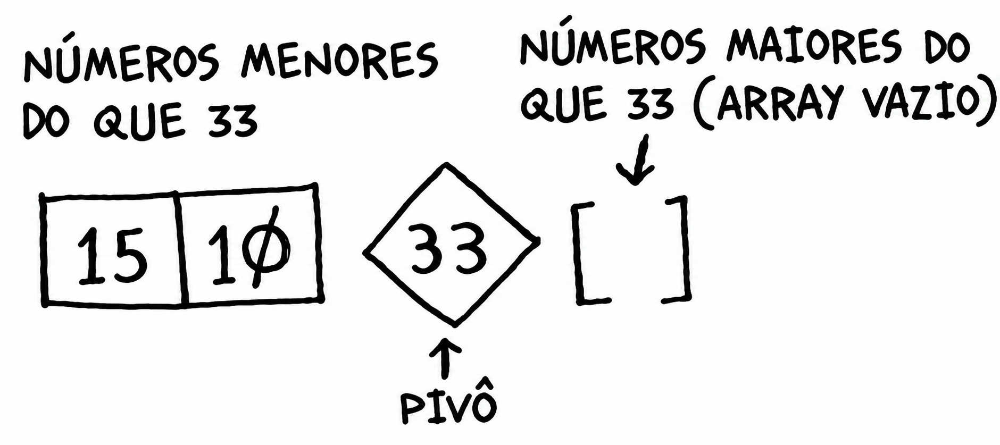
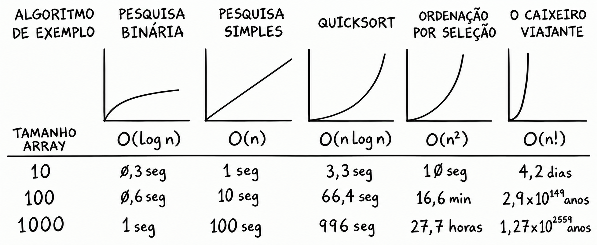

# Quicksort
É um **algoritmo de ordenação** muito rápido, elegante e amplamente utilizado na prática.

> É consideravelmente mais rápido do que a **[Ordenação por Seleção](../../capitulo-02-arrays-e-listas-ligadas/anotacoes/ordenacao-selecao.md)**.

## Como ele funciona?
- O Quicksort se apoia diretamente no uso de [**recursão**](../../capitulo-03-recursao/anotacoes/recursao.md) e aplica a técnica de [**Dividir para Conquistar (DC)**](dividir-conquistar-(DC).md).
- Em vez de tentar ordenar uma grande quantidade de dados de uma só vez, ele divide o problema em subproblemas menores até chegar a casos banais de ordenação (caso-base).

## Principais Destaques
- **Elegância de Código:** É frequentemente citado como um dos melhores exemplos de programação limpa e eficiente.
- **Aplicação Prática:** Demonstra como transformar uma estratégia genérica de resolução de problemas (DC) em um algoritmo eficiente do mundo real.

## Como Usar?

### 1. Casos-base

Não há necessidade de ordenar arrays que possuem zero ou um elemento, pois eles já estão ordenados.

$$
\begin{array}{rcl}
[\,] & \leftarrow & \text{Array vazio} \\
[20] & \leftarrow & \text{Array com um elemento}
\end{array}
$$

Esses são os **casos-base** do Quicksort. Eles permitem que a recursão termine.

### 2. Array com dois elementos

Quando o array possui dois elementos, basta verificar se estão na ordem correta. Caso contrário, trocamos suas posições.

$$
[1, 7]
$$

Nesse exemplo, os elementos já estão ordenados. Se tivéssemos `[7, 1]`, o resultado seria `[1, 7]`.

### 3. Escolha do pivô e particionamento

Considere o seguinte array:

$$
[33, 15, 10]
$$

Primeiro, escolhemos um elemento do array chamado **pivô**. Neste exemplo, utilizaremos o número `33`.

  <svg xmlns="http://www.w3.org/2000/svg" width="80" height="60" viewBox="0 0 80 60">
    <polygon points="40,3 77,30 40,57 3,30" fill="none" stroke="currentColor" stroke-width="2"/>
    <text x="40" y="35" text-anchor="middle" font-family="Arial, sans-serif" font-size="16" fill="currentColor">33</text>
  </svg>

Agora, separamos os elementos em três partes:

- **Subarray esquerdo:** elementos menores que o pivô.
- **Pivô:** o elemento escolhido.
- **Subarray direito:** elementos maiores que o pivô.

Após o particionamento, temos:

$$
[15, 10] \quad 33 \quad [\,]
$$

Os números `15` e `10` são menores que `33`, portanto ficam à esquerda. Como não há elementos maiores que `33`, o subarray direito fica vazio.

### 4. Ordenação recursiva

Agora, aplicamos o Quicksort novamente ao subarray esquerdo:

$$
[15, 10]
$$

Como o primeiro elemento é maior que o segundo, trocamos suas posições:

$$
[10, 15]
$$

O subarray direito já está vazio, então não precisamos fazer mais nada com ele.

Por fim, combinamos o subarray esquerdo, o pivô e o subarray direito:

$$
[10, 15] + [33] + [\,] = [10, 15, 33]
$$

**Resultado:** `[10, 15, 33]`.

### 5. Exemplo com quatro elementos

Considere agora o array:

$$
[33, 10, 15, 7]
$$

Escolhemos novamente o número `33` como pivô. Após o particionamento, todos os outros elementos ficam à esquerda, pois são menores que `33`.

Temos, portanto:

$$
[10, 15, 7] \quad 33 \quad [\,]
$$

Aplicamos o Quicksort recursivamente ao subarray `[10, 15, 7]`, até que seus elementos estejam ordenados.

O resultado da ordenação desse subarray é:

$$
[7, 10, 15]
$$

Combinando as partes, obtemos:

$$
[7, 10, 15] + [33] = [7, 10, 15, 33]
$$

**Resultado final:** `[7, 10, 15, 33]`.

> **Importante:** a lógica funciona com diferentes escolhas de pivô. Entretanto, a escolha pode influenciar o desempenho do Quicksort, pois determina como os elementos são divididos entre os subarrays.

> Veja a implementação do algoritmo em Python no arquivo [`quicksort.py`](../codigo/quicksort.py).

## Notação Big O

> Estimativa não precisa, apenas para exemplificar os níveis de diferença.

- Na pior situação, o **Quicksort** tem tempo de execução \(O(n^2)\).
- O **Quicksort** tem tempo de execução \(O(n \log n)\) no caso médio.

---

Se o Quicksort tem tempo de execução médio \(O(n \log n)\), e o Merge Sort tem tempo de execução \(O(n \log n)\) sempre, por que não utilizar o Merge Sort?

## Merge Sort vs Quicksort

O Merge Sort e o Quicksort são algoritmos de ordenação que podem apresentar tempo de execução \(O(n \log n)\). Então, por que o Quicksort costuma ser mais rápido na prática?

A resposta está nas **constantes e no caso de execução considerado**.

### 1. A importância das constantes

A notação Big O descreve como o tempo de execução cresce conforme a quantidade de elementos \(n\) aumenta. Entretanto, ela não considera as constantes multiplicativas.

Por exemplo, imagine duas funções que percorrem uma lista de \(n\) elementos:

- Função A: leva \(10n\) milissegundos.
- Função B: leva \(1000n\) milissegundos.

As duas possuem tempo de execução \(O(n)\), pois percorrem a lista uma vez. Porém, a função A é muito mais rápida porque apresenta uma constante menor.

O mesmo princípio pode ser aplicado a algoritmos de ordenação.

### 2. Comparando Merge Sort e Quicksort

O Merge Sort possui tempo de execução \(O(n \log n)\), inclusive no pior caso. O Quicksort também apresenta \(O(n \log n)\) no caso médio, mas pode chegar a \(O(n^2)\) no pior caso.

Quando comparamos os desempenhos de ambos em condições típicas, há outro fator importante: **o Quicksort possui uma constante menor que a do Merge Sort**, conforme a explicação do livro.

Podemos representar essa ideia de maneira simplificada:

\[
T_{\text{Merge Sort}}(n) \approx c_m n \log n
\]

\[
T_{\text{Quicksort}}(n) \approx c_q n \log n
\]

Em que \(c_m\) e \(c_q\) representam constantes associadas ao custo das operações de cada algoritmo. Na comparação apresentada pelo livro, \(c_q < c_m\).

Embora ambos tenham o mesmo crescimento assintótico no caso médio, o Quicksort tende a executar em menos tempo devido à constante menor.

### 3. Conclusão

O Merge Sort apresenta tempo de execução \(O(n \log n)\) garantido, enquanto o Quicksort pode atingir \(O(n^2)\) no pior caso. Apesar disso, o Quicksort costuma ser mais rápido na prática por ter uma constante menor e apresentar \(O(n \log n)\) no caso médio.

> algoritmos com a mesma notação Big O não necessariamente levam o mesmo tempo para executar. As constantes também podem fazer diferença.

