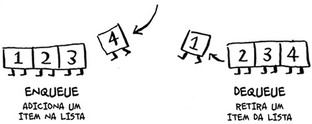

# Filas 
Uma fila em estrutura de dados funciona exatamewnte como uma fila da vida real.
> Não se pode acessar elementos aleatórios em uma fila.

Duas Operações são possiveis:
- euqueue (enfileirar)
- dequeue (desenfileirar)

 

## Fila vs Pilha
A **fila** é uma estrutura de dados **FIFO**, já a **[pilha](../../capitulo-03-recursao/anotacoes/pilha-stack.md)** é uma estrutura de Dados **LIFO**.
- FIFO - First In, First Out
- LIFO - Last In, First Out

 
