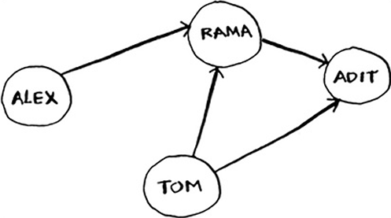
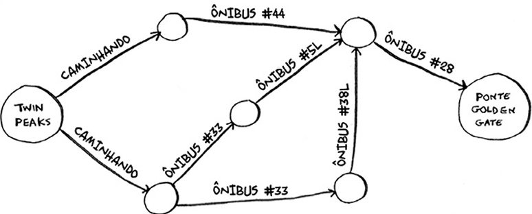
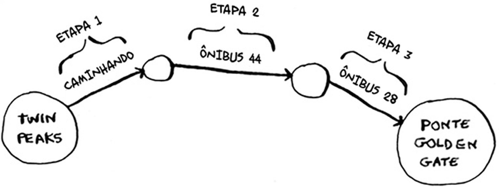
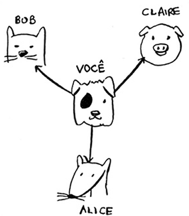
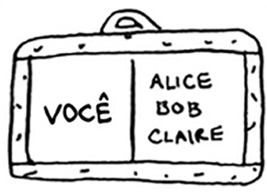
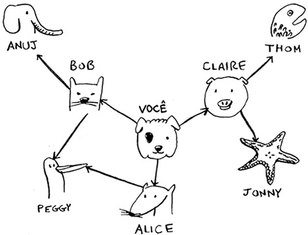
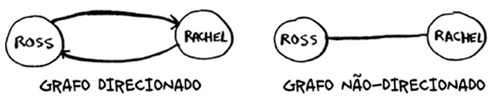

# Grafo
O modelo de grafo é um conjunto de conexões, são formador por vértices e arestas. É uma maneira de modelar como eventos diferentes estão conectados entre si.


> ***Grafo de pessoas que devem dinheiro a outras pessoas em uma partida de pôquer***

---

## Exemplo:

> **Grafo de *Twin Peaks* até a *Ponte Golden Gate***


> Caminho mais rápido até a *Ponte Golden Gate*

### Etapas para descobrir como ir de *Twin Peaks* até a ponte *Golden Bridge*
Esse tipo de Problema é chamado de *problema do caminho mínimo*, e o algoritmo que resolve problemas de caminho mínimo é a [*pesquisa em largura*](pesquisa-em-largura.md).

1. Modele o Problema utilizando [Grafos](#grafo).
2. Resolva o problema utilizando a [pesquisa em largura](pesquisa-em-largura.md).

## Implementando Grafo
Como expressar uma relação do tipo "você --> bob"? 
Estrutura de dados que lhe permite expressar relações: ***[Tabela Hash](../../capitulo-05-tabelas-hash/anotacoes/tabelas-hash.md)***

<div style="display: flex; align-items: center; gap: 15px;">
    
    <span>--></span>
    
</div>

```python
grafo = {}
grafo["você"] = ["alice", "bob", "claire"]
```

 

```python
grafo = {}
grafo["voce"] = ["alice", "bob", "claire"]
grafo["bob"] = ["anuj", "peggy"]
grafo["alice"] = ["peggy"]
grafo["claire"] = ["thom", "jonny"]
grafo["anuj"] = []
grafo["peggy"] = []
grafo["thom"] = []
grafo["jonny"] = []
```

Anuj, Peggy, om e Jonny não têm vizinhos. Eles têm setas apontadas para
eles, mas nenhuma seta partindo deles para outros.

Isso se chama ***dígrafo*** (ou **grafo direcionado**), onde a relação acontece apenas em um sentido.
Anuj é vizinho de Bob, mas Bob não é vizinho de Anuj.

Um **grafo não direcionado** (ou simplesmente grafo) não contém setas, e ambos os vértices são vizinhos um do outro.

Como exemplo, podemos dizer que ambos os grafos mostrados a seguir são iguais:

 