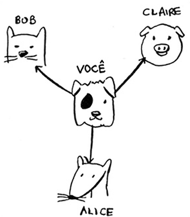
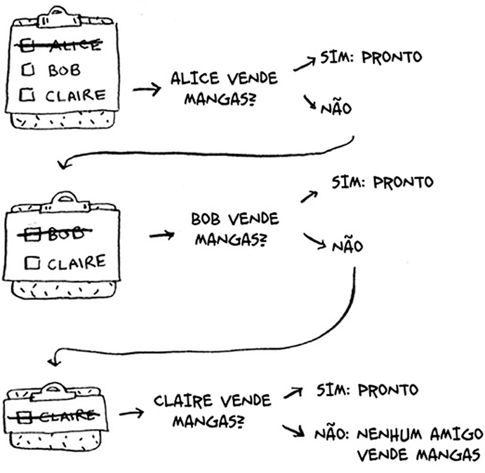
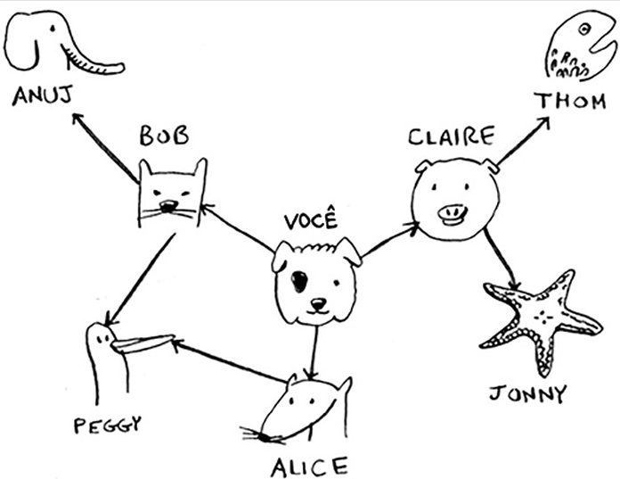
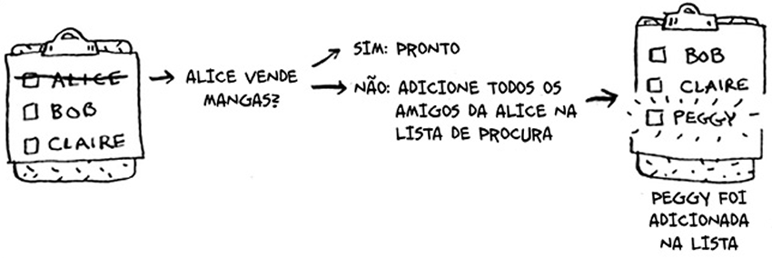
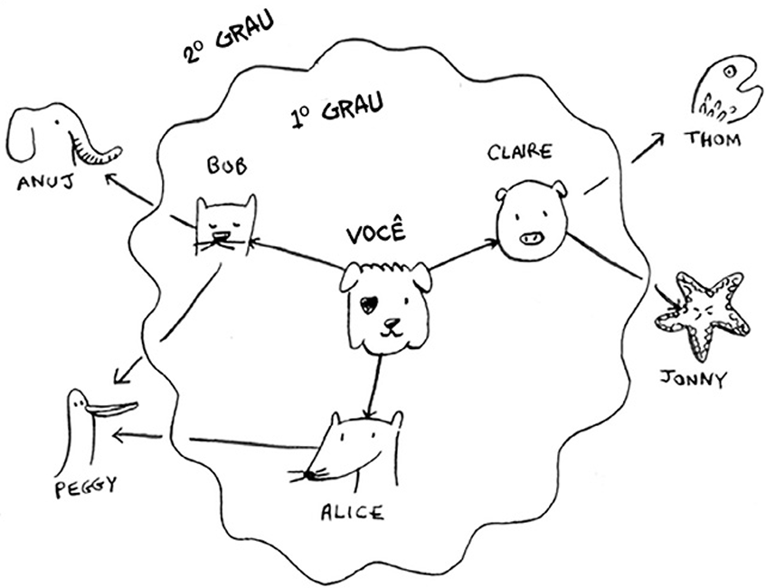

# Pesquisa em Largura (Breadth-First Search - BFS)
Este algoritmo ajuda a responder a dois tipos de pergunta:
1. Existe algum caminho do vértice A até o Vértice B?
2. Qual o caminho mínimo do vértice A até o vértice B?

## Como funciona?
Ele recebe um Grafo e o Tranforma em uma Lista, e com essa lista/[fila](fila.md) faz as devidas verificações.

> Caçando um Vendedor de Manga

    
    -->
    

Se não tiver um vendedor de manga entre os seus amigos.

 

você terá que buscar entre os amigos dos seus amigos.

 

Cada vez que você pesquisar uma pessoa da lista/[fila](fila.md), todos os amigos dela serão
adicionados à lista/[fila](fila.md).

 

Grafo Final  
 

O funcionamento da pesquisa em largura faz com que a pesquisa irradie do ponto inicial. Dessa forma, você verificará as conexões de primeiro grau antes das de segundo grau.  

## Implementando Algoritmo
1. Crie uma [fila](fila.md) contendo todas as pessoas que devem ser verificadas
2. Retire uma pessoa da fila (dequeue)
3. Confira se está pessoa é um vendedor de manga
4. Sim (Pronto) - Não [Adicione todos os vizinhos dela a fila (euqueue)]
5. Repita
6. Caso a fila esteja vazia, não existem vendedores de manga em sua rede

- Código [pesquisa-largura.py](../codigo/pesquisa-largura.py)

## Tempo de Execução
O(V+A)
- V --> Número de vértices
- A --> Númeor de arestas 