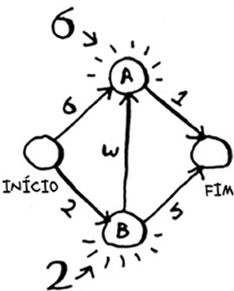
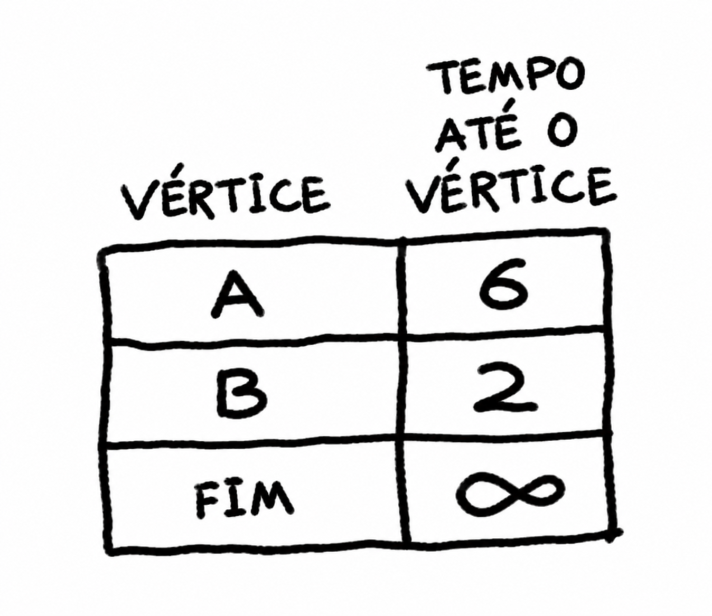
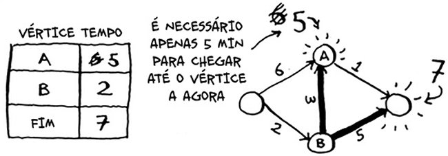
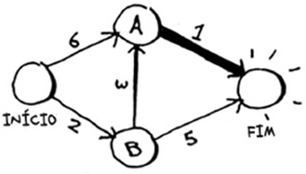
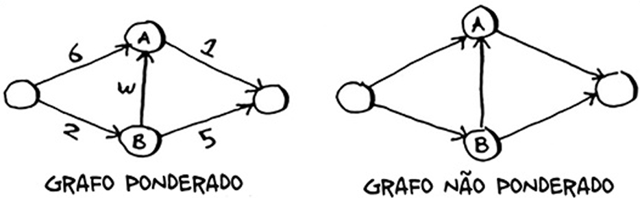
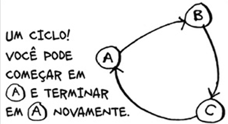
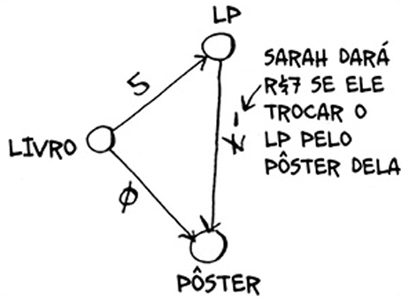

# Algoritmo de Dijkstra
Determina caminho mínimo até X para [grafos ponderados](#grafos-ponderados).
> Não necessarariamente o [caminho mais rápido](#algoritmo-de-dijktra) é o [caminho mais curto](../../capitulo-06-busca-em-largura/anotacoes/pesquisa-em-largura.md)

## Como ele funciona?
O Algoritmo de Dijkstra tem 4 Etapas:
1. Encontre o vértice mais "barato".
2. Atualize os custos dos vizinhos desse vértice.
3. Repita até que você tenha feito isso para cada vértice do grafo.
4. Calcule o caminho final.

### Exemplo: 
**1.** Encontre o vértice mais barato a partir do início.

> Distancias que ainda não são conhecidas são representadas com o ∞

**2.** Calcule quanto tempo leva para chegar até todos os vértices vizinhos de B.

1. Repita!

- demora 2 minutos para chegar ao vértice B
- demora 5 minutos para chegar ao vértice A
- demora 6 minutos para chegar ao 

## Terminologias

### Grafos Ponderados ou Grafo Valorado
Cada aresta do grafo tem um número associado a ela, eles são chamados de *pesos*.

> - Para calcular o caminho mínimo em um grafo não ponderado, utilize a [Pesquisa em Largura](../../capitulo-06-busca-em-largura/anotacoes/pesquisa-em-largura.md)
> - Para calcular o caminho mínimo em um grafo ponderado, utilize o [Algoritmo de Dijkstra](#algoritmo-de-dijkstra)

### Ciclos
Grafos podem conter ciclos, ciclos indicam que é possível começar em uma vértice, viajar ao redor dele e terminar no mesmo vértice.

> Seguir o ciclo jamais fornecerá o caminho mínimo

Um [grafo não direcionado](../../capitulo-06-busca-em-largura/anotacoes/grafos.md#implementando-grafo) indica que dois vértices podem apontar um para o outro. Ou seja, um grafo não direcionado é um ***ciclo***!

> O Algoritmo de Dijkstra só funciona em gráficos sem ciclos ou em fráficos com um ciclo de peso positivo.

## Arestas com pesos negativos

A aresta do LP ao pôster tem um peso negativo ! *receberá* R$ 7 de *volta* se ele fizer essa troca, o que faz com que ele tenha duas maneiras de conseguir o pôster:

> - ⚠️ Você não pode usar o [algoritmo de Dijkstra](#algoritmo-de-dijkstra) se você tiver arestas com pesos negativos
> - Se quiser encontrar o caminho mínimo em um grafo contendo arestas com pesos negativos, existe um algoritmo específico para isso! Ele é chamado de ***algoritmos de Bellman-ford***.
> - Este algoritmo está fora do âmbito do livro.